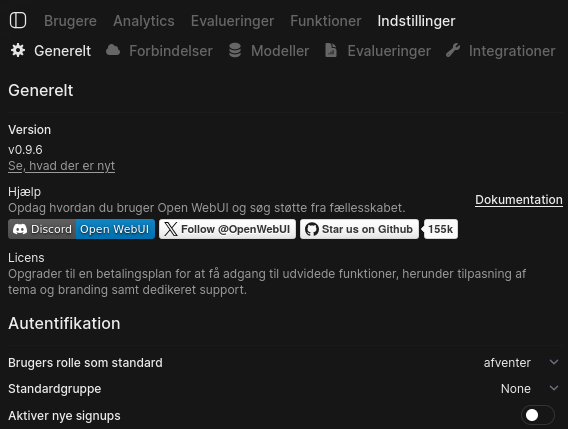
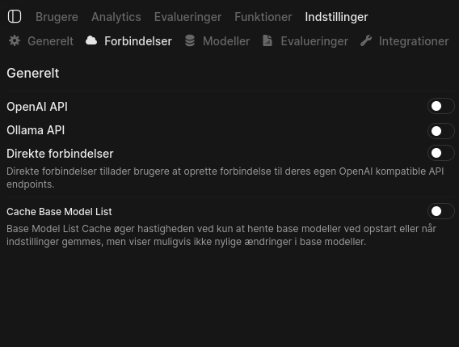
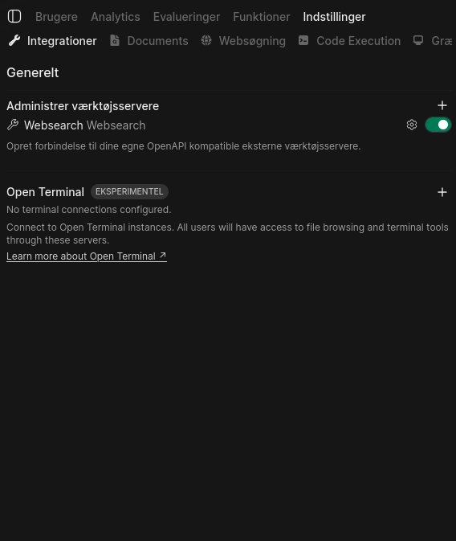
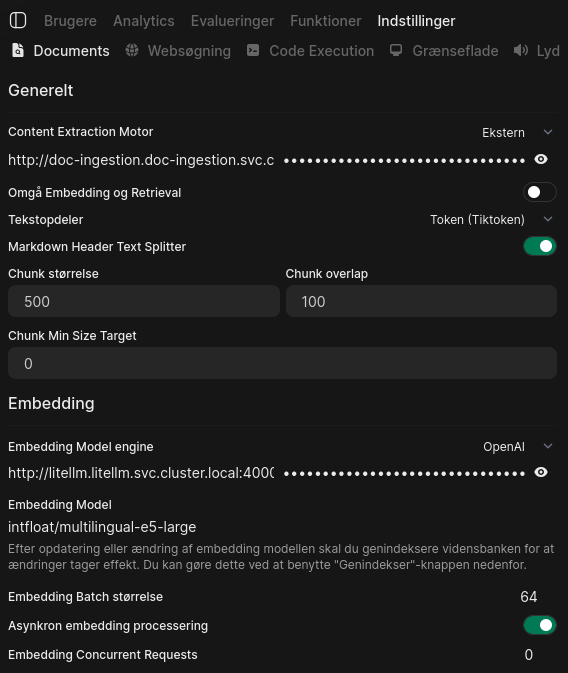
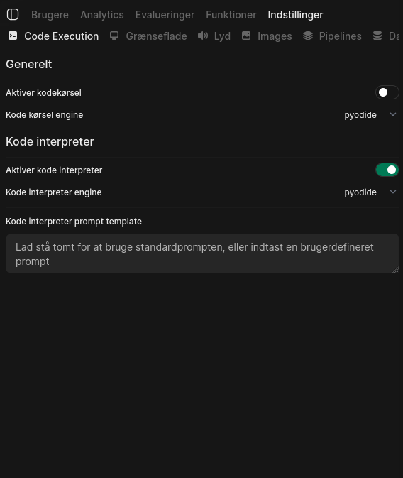

## Indstillinger i administrationspanelet

Vil man gerne lave ændringer til indstillingerne i administrationspanelet skal det gå igennem drifts- og
applikationsleverandøren. Årsagen hertil er uddybet i afsnittet 'Hvorfor Configuration as Code?' neden for.

Hvis der ikke benyttes en leverandør bør den lokale IT-administrator kontaktes.

### Leverandørkontakt ved ønske om ændringer

- [DTU Computerome](https://www.computerome.dk/) - [support@computerome-k8s.dk](mailto:support@computerome-k8s.dk)
- ???

### Midlertidige indstillinger

Når man er administrator har man mulighed for at ændre indstillinger midlertidigt under `administration`
(administrationspanel -> indstillinger). Da OS2ai er lavet så den anvender
Configuration as Code hvor indstillingerne gemmes, versioneres og udgives, vil ændringer lavet
i administrationspanelet blive overskrevet ved næste udgivelse.

Man kan desuden opleve at de ændringer man laver manuelt ikke bliver gemt, de skal gemmes i flere instanser,
og derfor skal man trykke gem i alle de instanser man har for at det slår rigtigt igennem. Ændringer vil senest blive rullet
tilbage ved den næste udgivelse. Potentielt før.

### Hvorfor er indstillingerne som de er?

Indstillingerne er originalt født ud af de erfaringer man gjorde sig hos ITK i Aarhus.
Med tiden er de blevet præget af henvendelser igennem [https://github.com/os2ai/Feedback/issues](https://github.com/os2ai/Feedback/issues).

OS2ai Standardindstillingerne findes i [github.com/os2ai/helm-deployments](https://github.com/os2ai/helm-deployments/blob/develop/applications/openwebui/values.yaml#L258-L615).

### Hvorfor Configuration as Code?

Det tillader at systemet er replikerbart og kan udrulles i en tilstand vi ved fungerer.
Ændringer i administrationspanelets indstillinger kan udgøre en alvorlig sikkerhedsrisiko,
da selv få ændringer kan svække løsningens sikkerhed væsentligt.

## Eksempler på kritiske indstillinger

Nedenstående beskrivelse af indstillinger er dem som OS2ai bliver født med.
Listen er ikke udtømmende og kan potentielt ikke være svarende med de faktiske [standardindstillinger](https://github.com/os2ai/helm-deployments/blob/develop/applications/openwebui/values.yaml#L258-L615).

Hvis man til trods for anbefalinger vil have dem ændret, så kontakt din leverandør.

### Autentifikation

- **Brugers rolle som standard**: Skal stå som `afventer`.
Hvis man benytter sig af FKA via. Adgangskomponenten vil man få tildelt sin rolle automatisk.
- **Standardgruppe**: Skal stå som `None`.
Hvis man benytter sig af FKA via. Adgangskomponenten vil man få tildelt grupper automatisk.
- **Aktiver nye signups**: Skal være slået fra.

### API

- **OpenAI API**: Skal være slået fra.
- **Ollama API**: Skal være slået fra.
- **Direkte forbindelser**: Skal være slået fra.

### Integrationer

- **Open Terminal**: Skal ikke have nogle forbindelser opkoblet.

### Documents

- **Content Extraction Motor**: Skal stå som `Ekstern` og med en intern cluster url, `http://doc-ingestion.doc-ingestion.svc.cluster.local:8000/api/v1`.
- **Omgå Embedding og Retrieval**: Skal være slået fra.
- **Tekstopdeler**: Skal være `Token (Tiktoken)`.
- **Markdown Header Text Splitter**: Skal være slået til.
- **Chunk størrelse**: Skal være `500`.
- **Chunk overlap**: Skal være `100`.
- **Chunk Min Size Target**: Skal være `0`.
- **Embedding Model engine** Skal stå som `OpenAI` og med en intern cluster url, `http://litellm.litellm.svc.cluster.local:4000/v1`.
- **Embedding Model**: Skal stå som `intfloat/multilingual-e5-large`.
- **Embedding Batch størrelse**: Skal stå til `64`.
- **Asynkron embedding processering**: Skal være slået til.

### Code Execution

- **Aktiver kodekørsel**: Skal være slået fra.
- **Aktiver kode interpreter**: Skal være slået til.
- **Kode interpreter engine**: Skal være `pyodide`.
