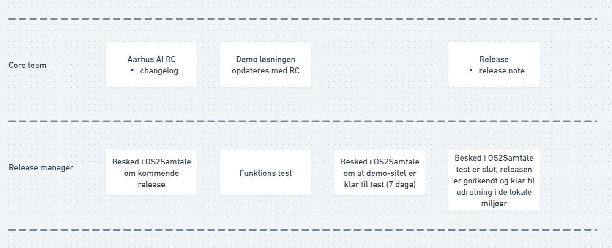

# Release management

Release management er opgaven med at klaregøre en ny release til produktion. Dette indebærer klargøring af en release
candidate (RC) til test, håndtering af testfeedback og klargøring af den endelige release. Når der er kommet en endelig
release skal andvendere sammen med deres leverandør selv planlægge deres egen release til deres produktions miljø.
Opgaven med release management håndteres af en release manager, det er beskrevet nedenfor hvordan denne udføres.

## Proces

1. Der kommer ny release af OpenWebUI, eller andre dele af AarhusAI
2. Core team laver en Release Candidate
3. Der informeres ud i OS2Samtale Release tråden at der er en ny release på vej, og hvad den indeholder
4. Release Candidate lægges på demostitet af Core Team
5. Release Manager tester på demositet, udfra de testcases der kan findes her:
   [https://aarhusai.github.io/documentation/admin/testcases.html](https://aarhusai.github.io/documentation/admin/testcases.html).
   Vær opmærksom på at det er funktionelle tests.
6. Release Manager skriver ud i OS2Samtale Release tråden at den nye release er klar til test, anvendere har 7 dage
   til at teste før releasen godkendes
7. Core team laver release og opdaterer changelog samt releasesiden i dokumentationen (se nedenfor)
8. Release Manager skriver ud i OS2Samtale Release tråden at den nye release er godkendt og klar til at blive rullet
   ud.



## Releasesider i dokumentationen

Hver release skal have en side under `releases/` i [dokumentationsrepoet](https://github.com/os2ai/documentation),
fx `releases/release0.8.md`. Siden indledes - direkte under overskriften - med linjen:

```markdown
Udgivet YYYY-MM-DD. Selve releasen på GitHub: <https://github.com/os2ai/helm-deployments/releases/tag/X.Y.Z>
```

Fremgangsmåde:

1. Find udgivelsesdatoen for release-tagget. Datoen er den samme i GitHub-release og CHANGELOG'en i
   helm-deployments, fx via `gh release view X.Y.Z --repo os2ai/helm-deployments --json publishedAt`.
2. Opret eller opdater releasesiden med dato og link til det konkrete release-tag, som vist ovenfor.
3. Hvis siden er oprettet undervejs i RC-forløbet, og en stable release endnu ikke findes, linkes til den aktuelle
   release candidate, og teksten angiver at der er tale om en RC. Link og dato rettes til stable-tagget når den
   endelige release er udgivet.
4. Et supplerende "Flere tekniske detaljer"-link føjes kun til hvis det peger på andet end release-linket ovenfor,
   fx en RC-side med detaljerede patch-noter. Link der peger på samme release udelades.

## Koordinationsgruppens rolle

Når en ny release frigives til demositet tester Koordinationsgruppen i OS2ai releasen. Koordinationsgruppen kan f.eks.
teste nye funktionaliteter, men også at lokalt-udviklede AI-assistenter stadig fungerer.
Kommunikation omkring ny release foregår på OS2samtale.
